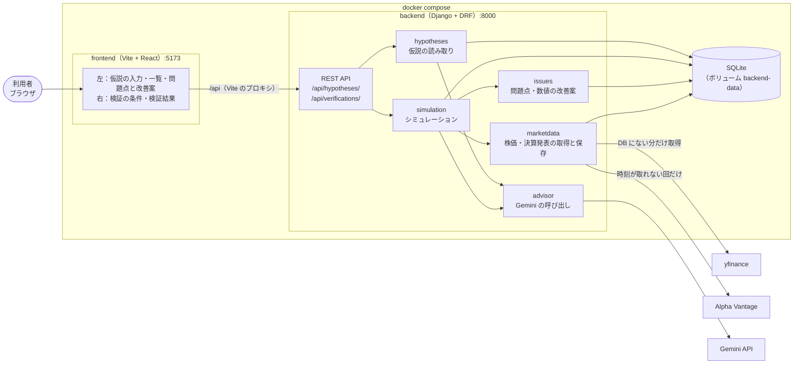

# 株式取引 仮説検証

米国株の売買の仮説を文章で保存し、過去の株価データでシミュレーション検証して、結果と仮説の問題点・改善案を表示する Web アプリです。

## サービス概要

機能は次の3つです。

1. **仮説の保存・編集・削除**
   - 仮説を自由な文章で入力すると、生成AI（Gemini）がトリガー条件・購入条件・購入方法・売却条件に読み取ります。
   - 読み取った結果を確認してから保存します。検証できない文章の場合は、検証できる形に補った文章を提案します。
2. **検証結果の表示**
   - 銘柄（複数）・検証期間・購入金額を指定して検証します。
   - 過去の1時間足（市場前・市場後を含む）で売買をシミュレーションします。
   - 検証した仮説・期間・総取引回数・損益額を、銘柄ごとと全銘柄の合計で表示します。取引の明細も表示します。
3. **問題点の提示**
   - 時間帯・トリガー条件・トリガー条件の数値・取引回数の観点から、決まったルールで問題点を判定します。
   - 改善案として、次の2種類を表示します。改善案から、新しい仮説を作って検証することもできます。
     - 購入条件の % を変えて再検証した結果（31通りの中で一番良かったもの）
     - 生成AIによる時間帯・トリガー条件の提案（未検証）

検証できる仮説は、決算発表の前後の売買です。例：

> 決算発表時刻を含む1時間足の、1本前の1時間足が確定したときに、その1時間足の終値から +2% の価格で、逆指値で買う。市場前・市場後に買った場合は市場前の最後の1時間足の終値で全売却し、市場中に買った場合は市場中の最後の1時間足の終値で全売却する。

実際のお金を使った取引は行いません。利用者は開発者本人だけを想定しています。

## 開発背景と解決したい課題

決算発表の前後で、「こう動いたら、こう買えば利益が出るのではないか」という売買の仮説を思いついても、それが本当に通用するかを確かめるのは手間がかかります。過去の値動きを1回ずつ手で追うのは大変で、回数が少ないと、たまたまの結果を信じてしまいます。また、仮説のどこが悪いのかも分かりにくいです。

このアプリでは、次のことを目指しています。

| 課題 | このアプリでの解決 |
|---|---|
| 仮説を過去のデータで確かめるのに手間がかかる | 仮説を文章で書くだけで、複数の銘柄・期間をまとめてシミュレーションできる |
| 結果が正しいか、毎回同じになるか信頼できない | 取得した株価データを DB に保存し、上書きしない。同じ条件なら何度検証しても同じ結果になる |
| 結果の良し悪しだけでは、何を直せばよいか分からない | 問題点を観点ごとに理由つきで示し、数値の改善案（再検証済み）と、生成AIによる別の案を示す |
| たまたまの結果を信じてしまう | 総取引回数を必ず表示する。回数が少ないことを問題点として示し、改善案には過学習の注意書きを付ける |
| 有料のデータやサービスは使いたくない | 株価データは yfinance、生成AIは Gemini の無料枠など、無料で使えるものだけで作る |

## 使用技術スタック

| 区分 | 技術 |
|---|---|
| バックエンド | Python 3.12、Django 5.2、Django REST Framework |
| フロントエンド | React 19、TypeScript、Vite |
| データベース | SQLite |
| 株価データ | yfinance（1時間足・決算発表日時。直近730日分）、pandas |
| 決算発表の区分（補助） | Alpha Vantage API（yfinance で発表時刻が取れない回だけ使う。無料枠） |
| 生成AI | Gemini API（google-genai。無料枠） |
| 市場の休場日 | holidays（NYSE のカレンダー） |
| テスト | pytest、pytest-django |
| リント | oxlint（フロントエンド） |
| パッケージ管理 | uv（Python）、npm（Node.js） |
| 実行環境 | Docker（docker compose）、WSL（Ubuntu） |

## システムアーキテクチャ



### 検証の流れ

1. **データの取得**：検証に必要な1時間足と決算発表日時のうち、DB にないものだけを yfinance から取得して保存します。保存済みのデータは上書きしません。
2. **シミュレーション**：DB に保存したデータだけを使って、銘柄ごとに売買を計算します。金額は Decimal で計算します。
3. **問題点の判定**：決まったルールで問題点を判定します。
4. **数値の改善案**：同じデータで、購入条件の % を -15%〜+15% の31通りに変えて再検証します。
5. **AI の提案**：Gemini に、時間帯・トリガー条件の別の案を3個出させます。Gemini が失敗した場合は、検証全体を失敗にします。
6. **保存**：結果・問題点・改善案をまとめて保存し、画面に返します。

### ディレクトリ構成

```
.
├── backend/            Django プロジェクト
│   ├── config/         設定・URL
│   ├── hypotheses/     仮説（保存・読み取り）
│   ├── marketdata/     株価データ・決算発表（取得・保存・時間帯の判定）
│   ├── simulation/     検証の実行・シミュレーション
│   ├── issues/         問題点・数値の改善案
│   ├── advisor/        Gemini の呼び出し・AI の提案
│   └── tests/          テスト（再現性の確認が中心）
├── frontend/           Vite + React + TypeScript
│   └── src/
├── specs/              仕様（spec.md、plan.md、tasks.md など）
└── compose.yaml
```

## 起動方法

```bash
cp backend/.env.example backend/.env   # GEMINI_API_KEY などを設定する
docker compose up -d --build
```

http://localhost:5173/ を開きます。詳しい手順と動作確認の方法は [quickstart.md](specs/001-stock-hypothesis-validation/quickstart.md) を参照してください。
